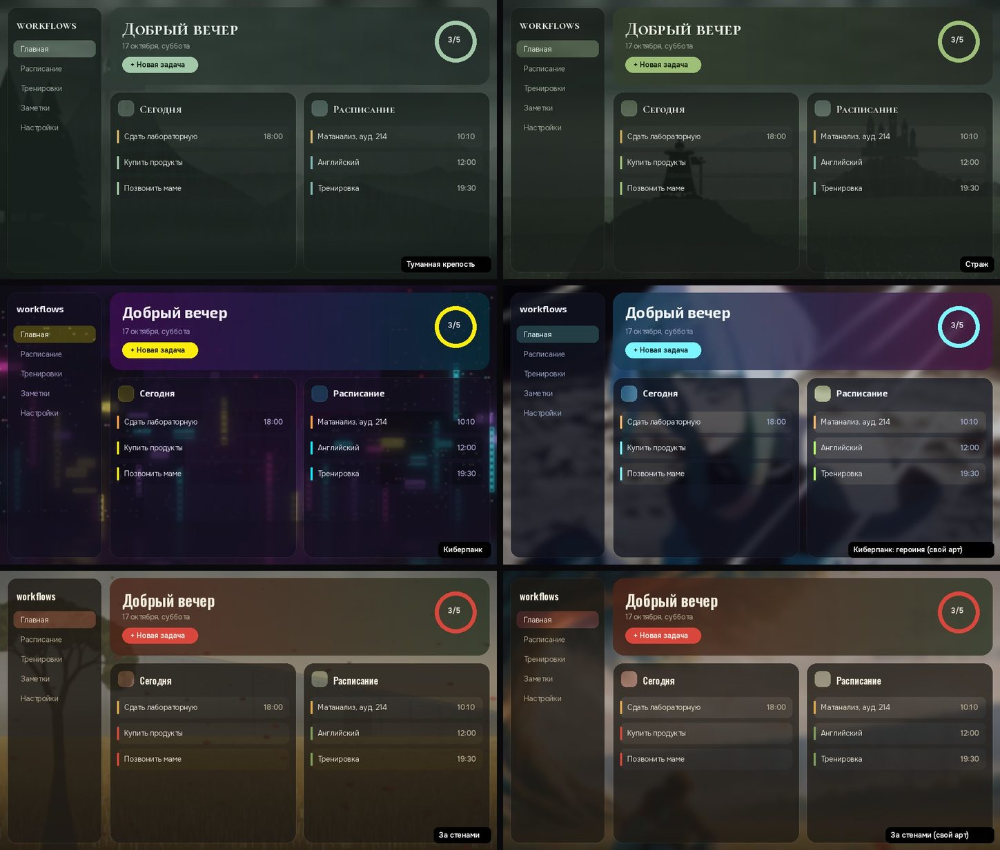

# workflows

Планировщик для Android и Windows: задачи с дедлайнами, календарь, расписание по часам, тренировки, утренняя рутина и заметки. Блоки на главном экране включаются галочками и переставляются. Синхронизация между устройствами со сквозным шифрованием и 12 тем оформления.



- [Скачать и установить](#скачать-и-установить)
- [Аккаунт и приватность](#аккаунт-и-приватность)
- [Что умеет](#что-умеет)
- [Как сделать свой блок](#как-сделать-свой-блок)
- [Своя копия приложения (для разработчиков)](#своя-копия-приложения-для-разработчиков)

---

## Скачать и установить

Все версии лежат в разделе **[Releases](../../releases/latest)** этого репозитория (справа на главной странице). Открывайте самый верхний релиз с пометкой **Latest**, в нём внизу есть блок **Assets**.

| Файл | Для чего |
|---|---|
| `workflows-android.apk` | Android-телефон или планшет |
| `workflows-Setup.exe` | Windows 10/11, установщик |
| `workflows-windows-portable.zip` | Windows без установки: распаковать и запустить `zadachnik.exe` |

### Android
1. Откройте страницу релиза **на телефоне** и нажмите `workflows-android.apk`.
2. Когда файл скачается, нажмите «Открыть». Android попросит разрешить установку из этого источника (браузера или «Файлов»): **Настройки → Разрешить из этого источника**, затем вернитесь назад.
3. Нажмите **Установить**. Если Google Play Защита предупредит о неизвестном разработчике: **Подробнее → Всё равно установить**. Приложение не из Play Маркета, поэтому предупреждение нормальное.
4. При первом запуске разрешите уведомления, если нужны напоминания о дедлайнах.

### Windows
1. Скачайте `workflows-Setup.exe` и запустите.
2. Установщик не подписан платным сертификатом, поэтому SmartScreen может показать «Windows защитила ваш компьютер». Нажмите **Подробнее → Выполнить в любом случае**.
3. Пройдите установку. Ярлык появится в меню «Пуск» и, если отметить галочку, на рабочем столе.

### iPhone и Mac
Пока нет.

### Обновления
Приложение само проверяет новые версии в этом репозитории. Когда версия выходит, на главном экране появляется плашка, и обновиться можно одной кнопкой: **Настройки → Обновления → Обновить**. Задачи и настройки при обновлении сохраняются.
На Android при первом обновлении нужно один раз разрешить приложению workflows «Установку неизвестных приложений», приложение само откроет нужный экран.

---

## Аккаунт и приватность

- Для входа нужна почта и пароль. Регистрация **по коду приглашения** вида `WF-XXXX-XXXX`: его выдаёт владелец приложения, каждый код можно использовать ограниченное число раз. Одним аккаунтом пользуются телефон и компьютер, данные синхронизируются.
- **Данные шифруются на вашем устройстве** (AES-256-GCM, ключ получается из пароля через PBKDF2) и только потом уходят на сервер. Владелец сервера видит почту, число записей и время изменений, но не текст задач, заметок и расписания.
- Поэтому **забытый пароль восстановить нельзя**: без него данные не расшифровать. Запишите пароль. Если сомневаетесь, сохраняйте резервную копию: блок «Резервная копия» сохраняет всё в файл.
- Свои фоновые картинки хранятся только на устройстве и никуда не отправляются.

---

## Что умеет

**Всегда на экране:** новая задача (название, дедлайн, время, описание), «Сегодня», «Ближайшие 3 дня», календарь с цветными точками дедлайнов и тренировок.

**Блоки, которые включаются галочкой** (⚙ → «Блоки на экране», там же меняется порядок перетаскиванием):

| Блок | Что делает |
|---|---|
| Расписание | Неделя по часам: пары, встречи, разовые дела, чётные и нечётные недели |
| Сводка | Сколько задач сегодня, на 3 дня, просрочено, тренировок за месяц |
| Все задачи | Полный список задач |
| Тренировки | Планы тренировок и журнал по датам |
| Утренняя рутина | Шаги на каждое утро и серия дней подряд |
| Заметки | Быстрые заметки без даты, как «Избранное» в Telegram |
| Талисман | Своя гифка и подбадривающие фразы |
| Напоминания | Уведомления в день дедлайна (Android) |
| Резервная копия | Сохранить всё в файл и загрузить обратно |

**Темы** (Настройки → Оформление): Ночь, Сакура, Игровая, Тёмное фэнтези, Неон, Туманная крепость, Страж, Штормовая цитадель, Закатный рыцарь, Киберпанк, Киберпанк: героиня, За стенами. У каждой темы можно поставить свою картинку на фон и настроить размытие и затемнение (Настройки → Фон темы).

---

## Как сделать свой блок

Блок — это один файл на Dart в папке `lib/modules/` и одна запись в списке. Программировать на Flutter не обязательно: можно попросить ИИ-ассистента (Claude, ChatGPT и т. п.) написать файл по готовому промту ниже.

### Шаги
1. Сделайте **форк** этого репозитория (кнопка **Fork** вверху) и настройте сборку по разделу [Своя копия приложения](#своя-копия-приложения-для-разработчиков).
2. Скопируйте промт ниже в чат с ИИ, а в конце опишите свой блок своими словами.
3. ИИ вернёт файл `lib/modules/<имя>.dart` и строки для `lib/modules/registry.dart`. Создайте файл в своём форке (**Add file → Create new file**), а в `registry.dart` добавьте импорт и запись `AppModule(...)` (значок ✏️ у файла).
4. Сохраните изменения (**Commit changes**). GitHub сам соберёт новую версию за 10–15 минут, и установленное приложение предложит обновиться.
5. Если сборка упала (красный крестик во вкладке **Actions**), откройте упавший шаг, скопируйте последние 30–50 строк лога и отправьте их тому же ИИ с просьбой исправить.

Новый блок появится в «Блоках на экране», где его можно включить галочкой.

### Промт для ИИ

````text
Ты пишешь новый блок (модуль) для Flutter-приложения "workflows". Верни ПОЛНЫЙ код нового файла
lib/modules/<snake_case_имя>.dart и точные строки, которые нужно добавить в lib/modules/registry.dart.
Остальные файлы не меняй, если без этого можно обойтись. Если всё же нужно, покажи изменение целиком.

Окружение:
- Flutter 3.24.5, Dart 3.5, Material 3, тёмные темы. Новые пакеты не добавляй без крайней
  необходимости; если добавляешь, версия должна поддерживать Flutter 3.24 (pubspec.yaml).
- Платформы: Android и Windows. dart:io можно, dart:html нельзя.
- Весь текст интерфейса на русском.

Как устроен блок:
- Виджет блока: класс <Name>Module (StatelessWidget или StatefulWidget), корень — Panel:
    import '../widgets/common.dart';
    Panel(title: 'Заголовок', icon: Icons.xxx, tone: C.accent, count: 3 /*необяз.*/,
          trailing: Widget? /*кнопка справа от заголовка, необяз.*/, child: ...)
- Регистрация в lib/modules/registry.dart: import '<имя>.dart'; и запись в список allModules:
    AppModule(
      id: '<уникальный_id>',          // никогда не менять после выпуска
      title: 'Название в списке блоков',
      description: 'Одна строка: что делает блок',
      icon: Icons.xxx,
      builder: () => <Name>Module(),
      // androidOnly: true,          // если блок работает только на Android
    ),

Данные (синхронизируются между устройствами и шифруются автоматически):
- import '../core/scope.dart'; import '../core/store.dart'; import '../core/models.dart'; import '../core/dates.dart';
- final store = StoreScope.of(context);  // вызывать в build: блок перерисуется при изменении данных
- Запись — это Map<String, dynamic> (typedef Item) с обязательными полями 'id' и 'kind'.
  Для своего блока придумай новый kind, например 'habit'. Поля — только JSON-типы (строки, числа, bool, списки, map).
- Читать:   store.items.values.where((x) => x['kind'] == 'habit').toList()
            str(item, 'field') — безопасно достаёт строку.
- Создать:  store.put({'id': newId(), 'kind': 'habit', 'title': ..., 'created': DateTime.now().millisecondsSinceEpoch});
- Изменить: store.put({...item, 'field': newValue});   // put заменяет запись целиком, поле 'updated' ставится само
- Удалить:  store.remove(item['id'] as String);
- Даты храни строками 'YYYY-MM-DD': ymd(DateTime), todayStr(); время 'HH:MM'.
  Ещё есть human('YYYY-MM-DD') → «17 окт», plural(n, 'задача', 'задачи', 'задач').
- Задачи приложения уже есть: store.tasks (kind 'task': title, desc, due, time, done). Их можно показывать, но не ломай формат.
- Чтобы записи нового kind попадали в резервную копию, добавь его в список _kinds в lib/modules/backup.dart.
- Настройки только для этого устройства (не синхронизируются) — пакет shared_preferences.

Оформление (важно, иначе ошибка сборки или неверные цвета):
- Цвета только из активной темы: import '../core/theme.dart';
  C.fg (текст), C.muted, C.faint, C.bg, C.surface, C.surface2, C.line,
  C.accent / C.accentInk (акцент и текст на нём), C.workout, C.deadline, C.overdue, C.sun, C.lilac.
  Не используй Colors.blue и подобные: у приложения 12 тем, и цвета должны меняться вместе с темой.
- C.* — это геттеры, а не константы. НЕ ставь `const` перед виджетами и стилями, где есть C.* или display(...),
  например не `const TextStyle(color: C.fg)`, а `TextStyle(color: C.fg)`.
- Заголовки и крупные цифры: display(18) (шрифт темы), обычный текст — TextStyle(color: C.fg, fontSize: 14).
- Готовые элементы из common.dart: EmptyNote('Пока пусто'), Hint('подсказка'), SectionLabel('Раздел'),
  Tag('метка', color: C.lilac), CountPill(5), Dot(C.accent),
  PickerField(label:, value:, icon:, onTap:, onClear:), toast(context, 'Сохранено'),
  await confirmDialog(context, 'Удалить?') → bool, await pickTime(context, '09:00') → 'HH:MM'?.
- Кнопки: FilledButton / OutlinedButton / TextButton (стили уже заданы темой). Поля: TextField (тоже).
- Блок должен нормально выглядеть при ширине от 320 до 700 px: Wrap/Flexible вместо жёстких размеров,
  длинный список ограничивай («Показать ещё»).
- Не используй Expanded/ListView без ограничения высоты прямо внутри Panel: блок стоит в общей прокрутке.
  Для списков — Column, или ListView с shrinkWrap: true и physics: NeverScrollableScrollPhysics().
- У StatefulWidget освобождай контроллеры в dispose(). После await проверяй `if (!mounted) return;`.

В конце ответа коротко перечисли, какие файлы создать или изменить.

Мой блок:
<опишите здесь, что должен делать блок: какие данные хранить, что показывать, какие кнопки нужны.
Например: «Трекер привычек: список привычек, у каждой 7 кружков за последнюю неделю, тап отмечает день,
сверху серия дней подряд; добавление привычки через поле ввода и кнопку».>
````

### Вручную, без ИИ
Возьмите за образец готовый блок `lib/modules/notes.dart`. Он короткий и показывает всё основное: поле ввода, сохранение записей, список, поиск. Скопируйте его под новым именем, переименуйте классы и kind и добавьте запись в `registry.dart`.

---

## Своя копия приложения (для разработчиков)

Нужна, если хотите менять код или поднять свой сервер синхронизации. Установщики собирает GitHub, ставить на компьютер ничего не нужно.

1. **Fork** этого репозитория.
2. В форке: **Actions** → включите workflows (GitHub спросит один раз).
3. **Settings → Secrets and variables → Actions → New repository secret**:

   | Имя | Что вставить | Обязательно |
   |---|---|---|
   | `SUPABASE_URL` | адрес вашего проекта Supabase `https://….supabase.co` | для синхронизации |
   | `SUPABASE_ANON_KEY` | ключ anon / publishable вашего проекта | для синхронизации |
   | `ANDROID_KEYSTORE_BASE64` | ключ подписи APK в base64 | для обновлений APK поверх старой версии |
   | `ANDROID_KEYSTORE_PASSWORD` | пароль от ключа | вместе с предыдущим |
   | `ANDROID_KEY_ALIAS` | имя ключа | вместе с предыдущим |

   Без Supabase-секретов приложение работает локально, без входа и синхронизации.
   Ключ подписи создаётся командой
   `keytool -genkeypair -v -keystore upload.jks -storetype PKCS12 -keyalg RSA -keysize 2048 -validity 10000 -alias workflows`,
   а base64 из него — `base64 -w0 upload.jks` (Linux/macOS) или `certutil -encode upload.jks out.txt` (Windows, без строк BEGIN/END). Сам файл ключа в репозиторий не кладите.
4. Для своего Supabase создайте таблицу `items`: **SQL Editor → New query**, вставьте содержимое `supabase/setup.sql` → **Run** и включите регистрацию: **Authentication → Sign In / Providers → Allow new users to sign up**.
5. **Actions → «Сборка приложений» → Run workflow**, или просто сохраните любое изменение в ветке `main`. Через 10–15 минут в **Releases** появится релиз `build-N` с файлами. Хранятся 10 последних сборок.

Установленные из вашего форка приложения обновляются из вашего форка.

### Регистрация по приглашениям
Чтобы аккаунт могли создать только люди с кодом:
1. Supabase → **SQL Editor → New query** → вставьте `supabase/invites.sql` → **Run**.
2. Репозиторий → **Settings → Secrets and variables → Actions → вкладка Variables → New repository variable**: имя `INVITE_ONLY`, значение `true`. Пересоберите приложение: на экране регистрации появится поле «Код приглашения». На сайте то же поле включает строка `inviteOnly: true` в `config.js`.
3. Коды создаются в SQL Editor:
   ```sql
   select * from make_invites(1, 1, null, 'Саша');   -- один одноразовый код
   select * from make_invites(5, 1, 7);              -- пять кодов на 7 дней
   select * from make_invites(1, 10, 30, 'группа');  -- один код на 10 человек
   ```
   Остальные команды (кто по какому коду зарегистрировался, как отключить код) записаны в конце `invites.sql`.

Проверка идёт в базе, а не в приложении, поэтому убрать её из кода или форка бесполезно. Уже созданные аккаунты она не затрагивает.

### Сборка на своём компьютере (необязательно)
Нужны Flutter 3.24.5, Android Studio (для APK) и Visual Studio 2022 с «Разработкой классических приложений на C++» (для Windows).
```
flutter create --platforms=android,windows --org ru.zadachnik --project-name zadachnik .
python tool/patch_platforms.py android
python tool/patch_platforms.py windows
flutter pub get
dart run flutter_launcher_icons
flutter build apk --release --dart-define=SUPABASE_URL=... --dart-define=SUPABASE_ANON_KEY=...
flutter build windows --release --dart-define=SUPABASE_URL=... --dart-define=SUPABASE_ANON_KEY=...
```

### Устройство проекта
```
lib/
  main.dart                 запуск, тема, экран входа или главный
  core/crypto.dart          PBKDF2 + AES-GCM, совместимо с сайтом байт в байт
  core/store.dart           данные, аккаунт, синхронизация с Supabase, офлайн-очередь
  core/theme.dart           темы оформления и свои фоны
  core/layout.dart          какие блоки включены и в каком порядке
  core/notifications.dart   напоминания на Android
  core/updater.dart         проверка и установка обновлений из Releases
  modules/                  блоки экрана, по файлу на блок; registry.dart — их список
  screens/                  вход, главный экран, настройки, блоки
  widgets/                  общие элементы: панель, задача, фон, боковая панель
assets/bg/                  фоны тем
assets/fonts/               шрифты (лицензия SIL OFL, тексты лицензий рядом)
tool/patch_platforms.py     настраивает android/ и windows/ после flutter create
installer/zadachnik.iss     установщик Windows (Inno Setup)
supabase/setup.sql          таблица и правила доступа для своего сервера синхронизации
supabase/invites.sql        регистрация только по коду приглашения
.github/workflows/build.yml сборка APK и установщика, публикация релизов
```
Папок `android/` и `windows/` в репозитории нет: их создаёт `flutter create` при каждой сборке, а `patch_platforms.py` настраивает.
